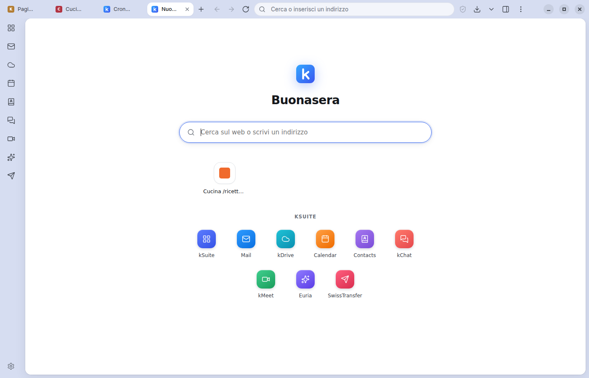
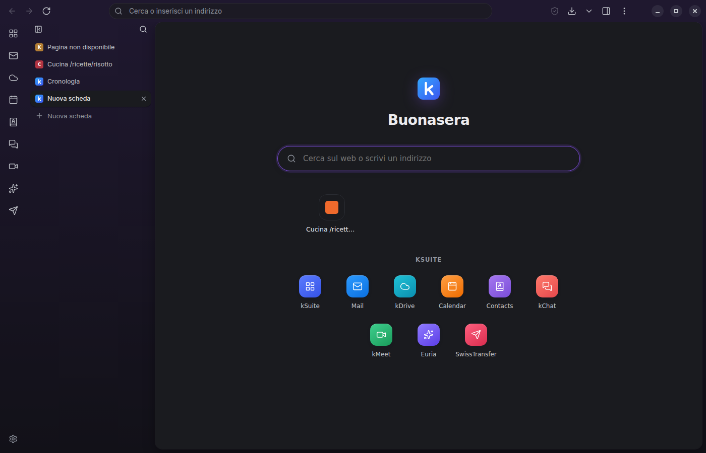

# Velo

Browser desktop (Windows, macOS, Linux) pensato per la **privacy e l'anonimato**: nessun contatto
con Google, protezione dal tracciamento e dal fingerprinting, finestre private, interfaccia
minimale e personalizzabile. Funziona senza alcun account; chi usa i servizi cloud di Infomaniak
(posta, kDrive, calendario, IA) può collegarli facoltativamente.





## Documentazione

- [Guida rapida](docs/GUIDA.md) e [domande frequenti](docs/FAQ.md)
- [Informativa sulla privacy](PRIVACY.md) e [sicurezza](SECURITY.md) (come segnalare una vulnerabilità)
- [Novità di ogni versione](CHANGELOG.md) e [come si pubblica una versione](docs/RILASCIO.md)

## Perché Electron + TypeScript

| Opzione | Pro | Contro per un *browser* |
| --- | --- | --- |
| **Electron + TypeScript** ✅ | Motore Chromium incluso e identico su ogni OS, API mature per schede (`WebContentsView`), download, permessi, PDF, menu contestuali | App più pesante (~100 MB) |
| Tauri (Rust) | Leggero | Usa il webview di sistema (WebKitGTK/WebView2/WKWebView): rendering diverso per OS e supporto multi-webview ancora instabile |
| Qt / PySide (QtWebEngine) | Chromium incluso | UI e packaging più laboriosi, ecosistema web meno ricco |

Per un browser servono un motore di rendering completo e controllo fine su schede, download e permessi:
Electron è la scelta più solida. Le app web di Infomaniak (Mail, kDrive, kMeet…) sono ottimizzate per Chromium,
quindi funzionano senza sorprese.

## Funzioni

**Organizzazione e comandi**
- **Pagina di benvenuto** al primo avvio: lingua, aspetto, livello di protezione, importazione dagli altri browser e
  account facoltativo, in cinque passaggi saltabili
- **Tavolozza dei comandi** (`Ctrl+K`): cerca tra comandi, schede aperte, sezioni delle impostazioni e preferiti; Invio
  esegue, e se nulla corrisponde apre l'indirizzo o cerca il testo
- **Scorciatoie personalizzabili** (Impostazioni › *Scorciatoie*): ogni comando del menu prende la scorciatoia che vuoi,
  con avviso se è già usata; `Ctrl+1…9` restano fisse
- **Gruppi di schede**: etichetta colorata con nome (doppio clic per rinominare), clic per comprimere, schede trascinabili
  dentro e fuori dal gruppo; menu del gruppo per colore, nuova scheda, separazione, chiusura
- **Spazi di lavoro**: ogni finestra mostra le schede di uno spazio alla volta (pulsante a sinistra delle schede o
  `Ctrl+Alt+←/→`); le schede degli altri spazi restano aperte e vengono ripristinate con la sessione
- **Contenitori** (Personale, Lavoro, Acquisti, Banca, o i tuoi): schede con cookie, accessi e dati propri, per essere
  connesso a due account dello stesso sito o tenere separati i siti; clic destro sul `+` o "Riapri in un contenitore"
  nel menu della scheda; una barretta colorata indica il contenitore. Ogni contenitore ha anche i propri permessi dei
  siti, e «Dimentica i siti alla chiusura» vale anche dentro i contenitori
- **Profili** (Impostazioni › *Profili*, menu File › Profili): un Velo separato per ogni profilo, con cronologia,
  preferiti, password, cookie e impostazioni propri; il nome compare nella barra e nel titolo della finestra
- **Impostazioni del sito** (`velo://site`, dal lucchetto o dalla tavolozza): permessi, protezioni, eccezione HTTP, zoom,
  cookie e "ricorda questo sito" in un solo posto, più l'elenco dei siti con impostazioni particolari

**Arresti anomali** (Impostazioni › Informazioni)
- Velo tiene in locale un breve elenco degli arresti anomali (quale processo, perché, versioni, sistema), ripulito da
  indirizzi, percorsi ed e-mail; nessun dump della memoria
- Dopo un arresto propone di segnalarlo: si apre una pagina di GitHub già compilata, che leggi e invii tu. Velo non
  manda mai nulla da solo; la proposta si può spegnere

**Accessibilità**
- **Tastiera**: `F6` passa da barra degli indirizzi a schede, barra degli strumenti, preferiti e pagina; nelle schede le
  frecce si spostano (anche sulle etichette dei gruppi), `Invio` apre, `Canc` chiude, il tasto menu (o `Maiusc+F10`)
  apre il menu della scheda; `Ctrl+K` raggiunge qualsiasi comando
- **Lettori di schermo**: schede e gruppi esposti come schede con il loro stato (fissata, audio, in pausa, gruppo,
  contenitore), etichette su tutti i pulsanti
- **Contrasto**: testi e controlli rispettano WCAG AA (4,5:1) in ogni tema, tavolozza e colore d'accento: i colori
  vengono corretti da soli; la tavolozza *Contrasto elevato* va oltre
- **Riduci movimento**, dal sistema o dalle impostazioni
- In CI ogni pagina interna e la finestra passano i controlli automatici di axe-core (WCAG 2.1 A e AA); restano
  da fare prove a mano con NVDA e VoiceOver

**Importazione dagli altri browser** (`velo://import`, anche dalla pagina di benvenuto)
- **Preferiti, cronologia, password e cookie** letti direttamente dai profili di Chrome, Edge, Brave, Vivaldi, Opera,
  Chromium e Firefox su questo computer, senza passare da Internet (anche con il browser aperto: Velo ne legge una copia)
- Le password e i cookie di Chromium vengono decifrati con la chiave che il sistema custodisce per quel browser
  (portachiavi di macOS, che chiede il permesso; Secret Service o chiave predefinita su Linux; DPAPI su Windows); quelle
  di Firefox con la sua chiave locale (NSS), se non c'è una password principale
- Resta l'importazione da file: preferiti in HTML, password in CSV

**Interfaccia su misura** (Impostazioni › *Aspetto* e *Disposizione*, oppure clic destro sulla barra degli strumenti)
- Stile «tela sospesa»: la pagina è una tela con gli angoli arrotondati appoggiata su uno sfondo tinto con il tuo colore;
  niente linee di separazione, una sola riga sopra la pagina
- **Colori**: colore d'accento libero (9 proposti o qualsiasi altro), tavolozza neutra, calda o ad alto contrasto,
  sfondo neutro, tinto o sfumato, tema chiaro/scuro/come il sistema. Il browser corregge l'accento se sarebbe poco leggibile
- **Forme e spazi**: arrotondamento degli angoli (da squadrati a tondi), densità compatta/normale/ariosa,
  pagina sospesa o da bordo a bordo
- **Caratteri**: Inter, del sistema, arrotondato, con grazie o monospaziato, in quattro dimensioni
- **Schede** su una riga insieme all'indirizzo, sopra l'indirizzo o **di lato** (colonna verticale ridimensionabile
  trascinandone il bordo e riducibile alle sole icone, schede fissate in griglia)
- **Barra delle app** (con l'account Infomaniak collegato) a sinistra, a destra o nascosta; icone essenziali o colorate
- **Barra degli strumenti componibile**: 13 pulsanti (indietro, avanti, ricarica, pagina iniziale, nuova scheda,
  protezioni, audio, download, cerca tra le schede, preferiti, cronologia, assistente IA, pannello) da aggiungere,
  togliere e riordinare con il trascinamento, prima o dopo l'indirizzo; anche da tastiera
- Indirizzo abbreviato (senza `https://` e `www.`) finché non lo modifichi, oppure sempre completo
- **Barra a scomparsa** (Ctrl+Maiusc+F, o in *Disposizione*): la pagina occupa tutta la finestra; schede e barra degli
  indirizzi ricompaiono portando il puntatore sul bordo in alto (o con Ctrl+L) e spariscono quando torni alla pagina,
  che scorre sotto la barra senza ridimensionarsi; facoltativamente ricompare anche scorrendo la pagina verso l'alto.
  Il pannello cloud resta visibile accanto alla pagina; su Linux i pulsanti della finestra li disegna Velo e spariscono
  con la barra
- **Animazioni** discrete (schede che si aprono e si chiudono, barre, tavolozza) che si spengono quando il sistema chiede
  di ridurre il movimento o con *Riduci le animazioni* nelle impostazioni
- Nuova scheda con sfondo semplice, tinto o sfumato e blocchi a scelta (saluto, siti più visitati, app)
- Anteprima dal vivo nelle impostazioni; tutto si applica subito, anche alle pagine del browser e ai popup

**Browser**
- Schede e più finestre, barra indirizzi/ricerca (DuckDuckGo, Qwant, Ecosia, Startpage, Google)
- **Suggerimenti nella barra degli indirizzi** da preferiti e cronologia, con navigazione da tastiera
- **Cronologia** (`velo://history`, `Ctrl+H`): ricerca, raggruppata per giorno, cancellazione di singole pagine o per periodo; mai registrata nelle finestre private
- **Preferiti**: stella nella barra degli indirizzi (`Ctrl+D`), barra dei preferiti (`Ctrl+Shift+B`), gestione (`velo://bookmarks`, `Ctrl+Shift+O`) con modifica, riordino e cartelle; **importazione ed esportazione** in formato HTML compatibile con Chrome, Edge, Firefox e Safari
- **Trova nella pagina** (`Ctrl+F`, `F3`/`Shift+F3`), con conteggio dei risultati e distinzione maiuscole/minuscole
- **Zoom** (`Ctrl +`, `Ctrl −`, `Ctrl+0`, `Ctrl`+rotellina) ricordato per ogni sito, zoom predefinito nelle impostazioni
- **Pagina nuova scheda** (`velo://newtab`): ricerca, siti più visitati (rimovibili) e, con l'account collegato, le app
- **Schede**: trascinamento per riordinarle, trascinamento fuori dalla finestra o in un'altra finestra per spostarle
  (la pagina resta aperta, senza ricaricarsi), schede fissate, audio on/off, duplicazione, "chiudi le altre",
  **riapri scheda chiusa** (`Ctrl+Shift+T`) con la sua cronologia avanti/indietro, `Ctrl+1…9`
- **Icone dei siti** salvate durante la navigazione e mostrate in preferiti, cronologia, suggerimenti e password
  (con un'iniziale colorata per i siti senza icona)
- Riapertura delle schede della sessione precedente (anche quelle fissate)
- Scorciatoie: `Ctrl+T`, `Ctrl+N`, `Ctrl+Shift+N` (finestra privata), `Ctrl+W`, `Ctrl+L`, `Ctrl+R`/`F5`, `Alt+←/→`, `Ctrl+Tab`, `Ctrl+,` (impostazioni), `Ctrl+Shift+Canc` (cancella dati), `Ctrl+PagSu/PagGiù` (schede), `F12` (su Mac: `⌘` al posto di `Ctrl`, cronologia con `⌘+Y`)
- Download con cartella configurabile o "chiedi dove salvare"
- **Modalità lettura** (icona del libro nella barra degli indirizzi o `F9`): solo il testo dell'articolo, senza pubblicità,
  menu e script; dimensione del testo, carattere con o senza grazie, colori chiaro/seppia/scuro, larghezza della colonna,
  tempo di lettura, "Ascolta" (sintesi vocale del sistema) e "Riassumi con l'IA". Estrazione con Readability (Mozilla),
  HTML dell'articolo ricostruito in modo sicuro
- **Cerca tra le schede** (`Ctrl+Shift+A` o il pulsante nella barra degli strumenti): tutte le schede delle finestre aperte,
  dalla più recente, con ricerca, chiusura (`Shift+Canc`) e schede chiuse di recente da riaprire
- **Sincronizzazione cifrata su kDrive**: preferiti, password (con codici 2FA, indirizzi e carte), cronologia, schede aperte, spazi di lavoro e contenitori tra i tuoi computer, cifrati
  end-to-end con una passphrase che conosci solo tu (vedi sotto)
- **Schede dormienti**: le schede non usate da un po' (1 ora, configurabile in Impostazioni › Generale) chiudono la pagina
  per liberare memoria e si ricaricano quando le apri, con la cronologia avanti/indietro intatta. Mai quelle fissate,
  delle app della barra, con audio in riproduzione o con moduli compilati. Anche "Metti in pausa" nel menu della scheda
- **Avvio veloce**: le schede della sessione precedente partono in pausa, si carica solo quella in primo piano
- Con molte schede aperte la barra le riduce all'icona e poi scorre (rotellina del mouse)
- **Passa alla scheda**: se la pagina che cerchi nella barra degli indirizzi è già aperta (anche in un'altra finestra),
  il suggerimento porta alla sua scheda invece di aprirne un doppione
- **Anteprima della scheda** al passaggio del mouse: titolo completo, sito, memoria usata, stato (in pausa, audio)
- **Completamento automatico** nella barra degli indirizzi (scrivi `git` → `github.com/`) dai siti visitati e dai preferiti
- **Anteprima del link** in basso a sinistra al passaggio del mouse
- **Informazioni sul sito** (clic sul lucchetto o su "Non sicuro"): stato della connessione, permessi concessi al sito, cancellazione di cookie e dati del sito
- **Stampa** (`Ctrl+P`), **salva pagina con nome** in HTML completo o MHTML (`Ctrl+S`), **sorgente pagina** (`Ctrl+U`)
- **Visualizzatore PDF** integrato
- **Netflix, Disney+, Prime Video, Spotify** e gli altri servizi con contenuti protetti: il browser usa
  [Castlabs Electron](https://github.com/castlabs/electron-releases) con Widevine, **spento finché non lo attivi** (il modulo arriva dai server di Google):
  quando un sito lo chiede compare «Attiva e riavvia», oppure Impostazioni › Privacy
- **Video e audio**: menu contestuale con riproduci/pausa, audio, ripeti, controlli, velocità, **picture-in-picture**
  (anche sui siti che lo disattivano), apri/salva/copia indirizzo; `Ctrl+Shift+P` mette in picture-in-picture il video
  principale della scheda (anche dentro i riquadri incorporati); pulsante nella barra con i controlli di tutte le schede
  che riproducono audio (pausa/riprendi, audio, picture-in-picture, vai alla scheda)
- **Video a schermo intero** (YouTube e simili): la pagina occupa tutta la finestra, `Esc` per uscire
- **Pagine d'errore chiare** (nessuna connessione, sito inesistente, certificato non valido…) con "Riprova";
  pagina dedicata se una scheda si blocca e avviso "La pagina non risponde"
- **Correttore ortografico** in italiano e inglese (su Windows e macOS quello del sistema, su Linux dizionari inclusi nel pacchetto) con suggerimenti e "Aggiungi al dizionario" nel menu contestuale
- **Siti con accesso HTTP** (nome utente e password richiesti dal server o dal proxy) tramite la barra informazioni
- **Browser predefinito** (Impostazioni › Generale): i link delle altre app e i file HTML/PDF si aprono qui, aggiunti alla sessione ripristinata

**Ricerca unificata** (`velo://search`, motore predefinito)
- Una sola ricerca dalla barra degli indirizzi trova insieme **preferiti e cronologia** e, con l'account Infomaniak collegato, **file di kDrive, email, contatti ed eventi**, con le parole cercate evidenziate
- **Calcolatrice** integrata (`12*(3+4)`), senza confondere date e numeri di telefono
- Collegamenti per continuare **sul web** con il motore scelto (DuckDuckGo, Qwant, Ecosia, Startpage, Google)
- Clic su un contatto per scrivergli dal pannello Mail, su un file per aprirlo in kDrive
- Nelle finestre private la cronologia non viene mai mostrata

**Assistente IA** (facoltativo, con l'account Infomaniak: AI Services, modelli ospitati in Svizzera)
- **Pannello IA** (`Ctrl+Shift+K` › IA): chat con risposte in streaming, azioni rapide sulla pagina aperta
  (riassunto, punti chiave, traduzione), opzione "Usa la pagina" per fare domande sul contenuto
- **Menu contestuale**: *Chiedi all'IA* sul testo selezionato (spiega, riassumi, traduci, migliora) e *IA: pagina* sulle pagine web
- **Domande dalla barra degli indirizzi**: scrivi `?` seguito dalla domanda (es. `?come si cucina il risotto`)
- **Risposta dell'IA nella ricerca unificata**: su richiesta, o automatica se la attivi (mai automatica nelle finestre private)
- **Scrivi con l'IA** nel pannello Mail: bozza dell'email partendo dall'oggetto e dai tuoi appunti
- Le risposte sono mostrate come testo formattato costruito in modo sicuro (nessun HTML del modello viene eseguito);
  il contenuto delle pagine è passato al modello come dato, non come istruzioni
- Si attiva in Impostazioni › Intelligenza artificiale (prodotto, modello, "Prova")

**Gestore password** (`velo://passwords`, menu File › Password)
- Dopo un accesso compare una barra per **salvare o aggiornare** la password (con "Mai per questo sito")
- **Compilazione automatica** quando per un sito c'è un solo accesso (solo su HTTPS); altrimenti clic nel campo e scelta dal menu, che il sito non può imitare perché è nativo
- **Password sicure suggerite** nei moduli di registrazione (20 caratteri casuali)
- **Codici di verifica (2FA)**: aggiungi a un accesso la chiave TOTP (il codice di configurazione o l'indirizzo
  `otpauth://` che il sito mostra col QR code); il codice compare nella pagina delle password con il conto alla
  rovescia e viene proposto nei campi del codice di verifica (anche quelli a una casella per cifra)
- **Indirizzi e carte di pagamento**, cifrati come le password: clic in un modulo di spedizione o di pagamento e scelta
  dal menu; le carte solo sulle pagine HTTPS, il codice di sicurezza (CVC) non viene mai salvato. Funziona anche nei
  moduli di pagamento incorporati (Stripe, Adyen…): lì solo le carte, solo con un clic vero e con il nome del fornitore
  nel menu, così sai a chi le stai dando
- Pagina di gestione: ricerca, mostra/copia, modifica, eliminazione, avvisi per password **riutilizzate** o **deboli**, siti esclusi
- **Importazione CSV** da Chrome, Edge, Firefox, Safari, Bitwarden, 1Password; **esportazione CSV** (richiede la password principale)
- **Password compromesse**: "Controlla ora" nella pagina delle password verifica se compaiono in violazioni di dati note
  (Have I Been Pwned) e le segna come "compromessa"; avviso anche al momento del salvataggio (disattivabile). Dal computer
  esce solo l'inizio (5 caratteri) dell'impronta SHA-1 di ogni password, con risposte "imbottite" che non rivelano nulla
- **Password principale** opzionale: blocca le password finché non la inserisci, con blocco automatico dopo 30 minuti di inattività
- Mai attivo nelle finestre private (nessun salvataggio né compilazione automatica)

**Impostazioni** (`velo://settings`, `Ctrl+,`)
- Generale: avvio, pagina iniziale, motore di ricerca, download
- Aspetto e disposizione: colori, forme, caratteri, posizione di schede e app, barra degli strumenti (vedi sopra)
- Privacy e sicurezza, permessi dei siti, account cloud (facoltativo), informazioni
- Ricerca tra le impostazioni

**Privacy e sicurezza**
- **Protezione dal tracciamento** con il motore Ghostery (EasyList, EasyPrivacy, liste uBlock Origin), liste aggiornate ogni settimana:
  *Standard* (pubblicità e tracker) o *Rigorosa* (anche banner dei cookie e altri fastidi)
- **Pulsante scudo** nella barra: quante richieste sono state bloccate e disattivazione delle protezioni per un singolo sito
- **Blocco dei cookie di terze parti**, sia sulle richieste di rete sia per gli script degli iframe (`document.cookie`):
  un tracker incorporato non può riconoscerti da un sito all'altro. I servizi incorporati che ne hanno bisogno
  (accessi, commenti) possono chiedertelo; vale dal riavvio. Lo storage dei siti incorporati (`localStorage`,
  IndexedDB) è separato per sito
- **Dimentica i siti alla chiusura** (facoltativo): quando chiudi l'ultima scheda di un sito, i suoi cookie e i suoi
  dati vengono cancellati; i *siti da ricordare* (impostazioni o pulsante scudo) restano
- **Livelli di sicurezza** *Standard*, *Più sicuro*, *Il più sicuro*, vedi [sotto](#livelli-di-sicurezza)
- **Do Not Track e Global Privacy Control** (`DNT: 1`, `Sec-GPC: 1`)
- **Modalità solo HTTPS**: le pagine `http://` vengono caricate in `https://`; se il sito non lo supporta compare un avviso con "Continua con HTTP" (le reti locali sono escluse)
- **DNS cifrato** (DNS over HTTPS): automatico (Quad9 con riserva sul DNS della rete), oppure solo Quad9 (Svizzera), Mullvad, Cloudflare o un indirizzo a scelta,
  così la rete (Wi-Fi pubblico, provider) non vede quali siti apri
- **Protezione dell'IP con WebRTC**: standard, protetta (predefinita: solo la connessione principale, l'IP reale resta
  nascosto dietro una VPN) o massima (nessun collegamento diretto); le chiamate di kMeet funzionano sempre
- **Protezione dall'impronta digitale** (fingerprinting), vedi [sotto](#protezione-dallimpronta-digitale)
- **Link puliti**: i parametri di tracciamento (`utm_…`, `fbclid`, `gclid`, `msclkid`, `si` di YouTube…) vengono tolti dagli
  indirizzi prima di aprire la pagina, e i link che passano da una pagina di rimbalzo solo per registrare il clic
  (`l.facebook.com`, `google.com/url`, `out.reddit.com`, `youtube.com/redirect`…) portano subito alla destinazione; "Copia link senza tracciamento" nel menu contestuale dei link
- **Protezione da phishing e malware**: i siti che rubano password e dati e i file di malware conosciuti vengono bloccati
  con una pagina di avviso, usando gli elenchi pubblici del progetto malware-filter (gli stessi di uBlock Origin),
  aggiornati due volte al giorno e controllati **sul computer**: nessun indirizzo viene inviato ad altri
- **Link ad app esterne** (`mailto:`, Zoom, Teams…): il browser chiede prima di aprirli (con "ricorda per questo sito");
  i tipi usati per attacchi (`ms-msdt:`, `search-ms:`, `ms-appinstaller:`, `file:`…) sono sempre bloccati
- **Download pericolosi** (programmi, script, immagini disco, documenti con macro): conferma prima di scaricarli,
  con un avviso in più se arrivano da una connessione non cifrata
- **Popup di accesso** (Google, Microsoft, banche): il titolo della finestra mostra il sito e se la connessione è sicura
- **Identità del browser**: si presenta come un normale Chrome (senza "Electron" e il nome dell'app), più difficile da
  riconoscere e compatibile con gli accessi che rifiutano i browser Electron
- Le icone dei siti visitati non possono essere usate da una pagina web per scoprire la tua cronologia
- **Cancella dati di navigazione** (cookie e dati dei siti, cache, elenco download, permessi) e cancellazione automatica alla chiusura
- **Finestre private**: sessione solo in memoria (cookie, cache, permessi spariscono alla chiusura), i download non vengono caricati su kDrive
- **Permessi dei siti**: valori predefiniti (chiedi/blocca) per fotocamera e microfono, notifiche e posizione; scelte ricordate e revocabili

**Account cloud Infomaniak** (facoltativo: tutto quanto segue compare solo dopo aver collegato un account)
- Barra delle app con Mail, kDrive, Calendar, kChat, kMeet e le altre (ogni app resta in una scheda dedicata, login persistente)
- Badge con le email non lette, aggiornato ogni 2 minuti anche a pannello chiuso
- **Notifiche di sistema** per le nuove email e **promemoria degli eventi** di Calendar (anticipo configurabile);
  un clic sulla notifica apre Mail o Calendar. Si configurano in Impostazioni › Notifiche
- Pannello laterale (`Ctrl+Shift+K`):
  - **Home**: profilo, email non lette, eventi di oggi, ultime email
  - **kDrive**: sfoglia cartelle, cerca, scarica, carica file, scegli la cartella di destinazione
  - **Mail**: posta in arrivo e invio email
  - **Agenda**: eventi dei prossimi 7 giorni e creazione rapida di eventi
  - **Download**: con opzione "carica automaticamente su kDrive"
- **Salva la pagina come PDF su kDrive** (`Ctrl+Shift+S`, menu File o tasto destro sulla pagina)
- **Invia la pagina via Mail** (`Ctrl+Shift+M`, menu File o tasto destro sulla pagina)
- Menu contestuale: *Salva immagine/link su kDrive*, *Invia link via Mail*

## Collegare un account Infomaniak (facoltativo)

1. Vai su [Manager Infomaniak → Token API](https://manager.infomaniak.com/v3/ng/accounts/token/list).
2. Crea un token con questi scope: `user_info`, `drive`, `workspace:mail`, `workspace:calendar`.
3. Apri **Impostazioni** (`Ctrl+,`) → *Account cloud* → incolla il token → *Salva e verifica*.

Per l'**assistente IA** serve anche il prodotto **AI Services** attivo nel Manager Infomaniak
(è a consumo) e un token che includa anche lo scope relativo all'IA (AI Services). Poi Impostazioni → *Intelligenza artificiale* → attiva → *Prova*.

Il token è salvato cifrato con il portachiavi del sistema operativo (`safeStorage` di Electron)
e viene usato solo dal processo principale: le pagine web non possono leggerlo.
In alternativa puoi passarlo con la variabile d'ambiente `VELO_API_TOKEN`.

Se il tuo account ha più kDrive puoi sceglierlo nelle impostazioni (oppure indicare l'ID che trovi
nell'URL dell'app web: `.../kdrive/app/drive/<ID>`).

## Come sono protette le password

- Le password stanno in `passwords.json` nel profilo, cifrate con **AES-256-GCM** (una modifica al file ne impedisce la lettura).
- La chiave di cifratura è casuale e viene protetta dal **portachiavi del sistema** (Portachiavi di macOS, DPAPI di Windows,
  Secret Service/KWallet su Linux) oppure, se la imposti, dalla **password principale** (derivata con scrypt).
- Su Linux senza portachiavi Electron userebbe una chiave fissa uguale per tutti: in quel caso il browser la considera
  assente e chiede di impostare una password principale prima di salvare qualsiasi password.
- Le pagine web non possono leggere le password salvate di altri siti: l'origine di ogni richiesta è stabilita dal browser,
  non dalla pagina, e la compilazione avviene solo nel frame dello stesso sito.

## Sincronizzazione cifrata su kDrive

Preferiti, password, cronologia (ultimi 90 giorni) e schede aperte si sincronizzano tra i tuoi computer
attraverso il tuo kDrive (Impostazioni → *Sincronizzazione*), senza server di terzi.

- **Cifratura end-to-end**: i dati sono cifrati sul computer con AES-256-GCM, con una chiave derivata con scrypt da una
  **passphrase** che scegli tu (almeno 10 caratteri). Su kDrive finiscono solo file illeggibili: Infomaniak non vede
  i contenuti e **non può recuperare la passphrase**. Se la perdi, dalle impostazioni puoi eliminare i dati remoti e ricominciare.
- **Dove**: cartella `Velo Sync` nella radice del kDrive, con `sync-key.json` (parametri della chiave e un
  controllo per riconoscere la passphrase giusta, nessun segreto) e un file `device-<id>.ksync` per ogni computer.
  Ogni computer scrive solo il proprio file, così non ci sono conflitti di scrittura.
- **Unione**: per ogni elemento vince la modifica più recente; le cancellazioni si propagano (e vengono dimenticate dopo
  90 giorni). Al primo collegamento contano le date degli elementi, così un computer con copie vecchie non sovrascrive
  modifiche più recenti fatte altrove.
- **Quando**: all'avvio, ogni 10 minuti, poco dopo una modifica a preferiti o password, oppure con *Sincronizza ora*.
- Le **password** si sincronizzano solo quando il portachiavi è sbloccato (con la password principale, dopo averla inserita).
- Le **schede aperte** degli altri computer compaiono nella ricerca tra le schede (`Ctrl+Shift+A`). Le finestre private
  non vengono mai sincronizzate.
- La chiave viene ricordata con il portachiavi del sistema; dove non c'è (alcuni Linux) la passphrase viene chiesta a ogni avvio.

## Nessun contatto con Google

Chromium, il motore delle pagine, non invia statistiche; i contatti con Google venivano da tre funzioni, ora risolte:

| Funzione | Prima | Ora |
| --- | --- | --- |
| Widevine (Netflix…) | scaricato e aggiornato da Google a ogni avvio | spento finché non lo attivi |
| Correttore ortografico (Linux) | dizionari scaricati da Google | inclusi nel pacchetto |
| DNS cifrato «automatico» | sceglieva il DNS del sistema, spesso `dns.google` | Quad9, con riserva sul DNS della rete |

All'avvio, senza aprire siti, Velo contatta solo: le liste di blocco dei tracker e degli indirizzi pericolosi (GitHub,
GitLab), Quad9 per il DNS cifrato e, se lo colleghi, Infomaniak. La CI lo verifica a ogni modifica
(`scripts/net-audit.mjs`): avvia Velo con un profilo nuovo, registra il traffico con il log di rete di Chromium e
fallisce se compare qualsiasi altro host.

## Protezione dall'impronta digitale

Senza cookie un sito può riconoscerti dalle caratteristiche del dispositivo: come la scheda grafica disegna un'immagine,
come la scheda audio elabora un suono, quanti processori hai, lo schermo, i caratteri installati. Velo ha due modalità:

- **Standard** (predefinita, come il "farbling" di Brave): le letture di immagini canvas e WebGL e dell'audio vengono
  alterate in modo impercettibile (un bit su qualche pixel o campione), il numero di processori è plausibile ma non reale,
  la scheda grafica diventa generica, memoria, batteria, rete e caratteri locali non si leggono. L'alterazione dipende da
  una chiave casuale della sessione e dal sito: lo stesso sito vede valori stabili, due siti vedono valori diversi e
  dopo un riavvio cambiano tutti. Nessun sito smette di funzionare.
- **Rigorosa** (come Tor Browser): valori uguali per tutti, letture canvas vuote, schermo arrotondato alla finestra,
  lingua `en-US` (anche nell'intestazione `Accept-Language`), nessun elenco di microfoni e videocamere, nessun touch.

In entrambe le modalità i *client hints* che descrivono il dispositivo in dettaglio (versione esatta, build del sistema,
architettura, modello) non vengono mai inviati. La protezione vale anche negli iframe, con la chiave del sito principale
(un tracker incorporato in due siti vede due dispositivi diversi) e nei Web Worker (anche condivisi), dove viene iniettata
prima del codice del worker con la stessa chiave della pagina. Le funzioni sostituite appaiono native (`toString`
compreso). Dal pulsante scudo si possono spegnere tutte le protezioni per un sito.

In modalità rigorosa due persone diverse ottengono gli stessi valori (verificato con due profili: stessa immagine
canvas, stessi processori, memoria, lingua e dimensioni dello schermo).

## Livelli di sicurezza

Come in Tor Browser, Impostazioni › Privacy e sicurezza › *Livello di sicurezza* spegne le funzioni del web usate più
spesso negli attacchi:

| | Standard | Più sicuro | Il più sicuro |
| --- | --- | --- | --- |
| Compilatore JIT di JavaScript e WebAssembly | sì | no (dal riavvio) | no (dal riavvio) |
| JavaScript | sì | solo sui siti cifrati (https) | no |
| WebGL e WebGPU (anche nei worker) | sì | no | no |
| Audio e video automatici | sì | solo dopo un clic (dal riavvio) | solo dopo un clic (dal riavvio) |
| Caratteri scaricati dai siti | sì | sì | no |
| Protezione dall'impronta | come impostata | come impostata | rigorosa |

JavaScript viene spento con una regola `script-src 'none'` aggiunta alle pagine, che non possono rimuoverla. Un sito
di cui ti fidi si esclude dal pulsante scudo (resta spento il JIT, che vale per tutto il browser).

## Lingue

L'interfaccia è in **italiano** e **inglese**: Velo usa la lingua del sistema (inglese se non è tra quelle
disponibili) oppure quella scelta in Impostazioni › Generale › *Lingua* (vale dal riavvio). La lingua dell'interfaccia
non cambia quella che i siti ricevono (`Accept-Language`), che resta quella del sistema.

Nel codice i testi sono scritti in italiano dentro `tr('…')` (o `plural(n, '…', '…')`); il testo italiano è la chiave
e `src/shared/locales/en.ts` lo traduce. Il testo statico delle pagine HTML viene tradotto all'apertura. Il test
`test/i18n.test.ts` controlla che ogni testo abbia la traduzione e che i segnaposto `{0}`, `{n}` corrispondano.
Per aggiungere una lingua: un nuovo catalogo in `src/shared/locales/`, la sua sigla in `LOCALES` (`src/shared/i18n.ts`).

## Sviluppo

Requisiti: Node.js 22+.

```bash
npm install
npm start          # compila e avvia
npm test           # test unitari (client API, omnibox, utilità)
npm run e2e        # test end-to-end nel vero Velo (Playwright + Electron; su Linux senza schermo: xvfb-run -a npm run e2e)
npm run typecheck
```

A ogni modifica la CI esegue typecheck, test unitari, build, i test end-to-end (benvenuto, tavolozza, scorciatoie,
impostazioni del sito, barra a scomparsa, contenitori, gruppi, spazi di lavoro, profili, importazione da Chromium,
codici 2FA, indirizzi e carte, pulizia del profilo, link di rimbalzo, siti dimenticati) e la verifica di rete.

### Creare l'installer

```bash
npm run dist:win     # .exe (NSIS)
npm run dist:mac     # .dmg e .zip
npm run dist:linux   # AppImage e .deb
```

Gli installer finiscono in `release/`. Avviando a mano la GitHub Action `CI` (*Run workflow*) vengono creati
per tutti e tre i sistemi come artefatti scaricabili, senza pubblicare nulla.

## Aggiornamenti automatici

L'app si aggiorna dalle [GitHub Releases](https://github.com/froll0/kSuiteBrowser/releases) del progetto
(controllo 30 secondi dopo l'avvio e poi ogni 6 ore, oppure da *Aiuto › Controlla aggiornamenti*).

| Installazione | Comportamento |
| --- | --- |
| Windows (.exe) | scarica in background e installa al riavvio (anche con "Riavvia ora") |
| Linux AppImage | come Windows |
| macOS (.dmg) | avvisa della nuova versione e apre la pagina di download (l'installazione automatica richiede un'app firmata con un certificato Apple Developer) |
| Linux .deb | avvisa della nuova versione e apre la pagina di download |
| `npm start` | disattivati |

In *Impostazioni › Aggiornamenti* si può disattivare il download automatico.

### Pubblicare una nuova versione

```bash
npm version patch        # oppure minor / major: aggiorna package.json e crea il tag vX.Y.Z
git push --follow-tags
```

Il tag avvia la GitHub Action che crea una release in bozza, compila Windows, macOS e Linux, carica installer e
file `latest*.yml` (letti dall'app per trovare gli aggiornamenti) e infine pubblica la release. Se il tag non
corrisponde alla versione di `package.json` la pubblicazione si ferma.

In alternativa, senza creare il tag a mano: aggiorna `version` in `package.json`, poi su GitHub
*Actions › CI › Run workflow* con l'opzione **release**: la release crea il tag `vX.Y.Z` sul commit compilato.

Gli installer non sono firmati: Windows SmartScreen e macOS Gatekeeper mostrano un avviso alla prima installazione.
L'app verifica comunque l'integrità di ogni aggiornamento (SHA-512 dal file `latest*.yml` scaricato via HTTPS).

## Struttura

```
src/
  api/        Client REST Infomaniak (profilo, kDrive, Mail, Calendar, Contatti, AI Services) — senza dipendenze da Electron
  main/       Processo principale: finestre, schede, privacy, download, permessi, menu, IPC
  preload/    Ponti sicuri (contextBridge): UI del browser e pagine interne velo://
  renderer/   Interfaccia del browser (barra schede, barra delle app, pannello cloud)
  pages/      Pagine interne: velo://newtab, search, settings, history, bookmarks, passwords, https-only
  shared/     Tipi, canali IPC, schema delle impostazioni, regole privacy, barra indirizzi
test/         Test Vitest
```

## API utilizzate

| Servizio | Endpoint |
| --- | --- |
| Profilo | `GET api.infomaniak.com/2/profile` |
| kDrive | `GET /2/drive`, `GET /3/drive/{id}/files/{dir}/files`, `GET /3/drive/{id}/files/search`, `GET /2/drive/{id}/files/{file}/download`, `POST /3/drive/{id}/upload`, `POST /3/drive/{id}/files/{dir}/directory`, `DELETE /2/drive/{id}/files/{file}` |
| Mail | `GET mail.infomaniak.com/api/mailbox`, `.../mail/{mailbox}/folder`, `.../folder/{id}/message`, `POST/PUT .../draft` |
| Calendar | `GET /1/calendar/pim/calendar`, `GET/POST /1/calendar/pim/event` |
| Contatti | `GET /1/calendar/pim/contact/all` |
| AI Services | `GET /1/ai`, `GET /1/ai/models`, `POST /2/ai/{product_id}/openai/v1/chat/completions` (compatibile OpenAI, streaming SSE) |

Sono gli stessi endpoint usati dai connettori MCP ufficiali di Infomaniak.

## Contenuti protetti (Widevine)

Il browser è costruito su Castlabs Electron (ECS), che include Widevine. Il modulo è di Google e viene scaricato e
aggiornato dai suoi server: per questo resta spento (e l'aggiornamento dei componenti disattivato) finché l'utente non
attiva i contenuti protetti. Su Windows e macOS i servizi di streaming accettano solo app con **firma VMP di
produzione**, fatta con il servizio gratuito [Castlabs EVS](https://github.com/castlabs/electron-releases/wiki/EVS):

1. Crea l'account (una volta sola, sul tuo computer):
   ```bash
   python3 -m pip install --upgrade castlabs-evs
   python3 -m castlabs_evs.account signup
   ```
   Ti arriva un codice di conferma per email.
2. Su GitHub, *Settings › Secrets and variables › Actions*, aggiungi i secret `EVS_ACCOUNT_NAME` e `EVS_PASSWD`.
3. Le build successive (Windows e macOS) vengono firmate dall'hook `scripts/after-pack.cjs`; senza i secret la build
   funziona lo stesso, ma Netflix e simili rifiutano la riproduzione.

Su Linux Widevine funziona senza firma VMP (con qualità video limitata da alcuni servizi).

## Sicurezza dell'app installata

L'installer attiva i *fuse* di Electron: niente `ELECTRON_RUN_AS_NODE`, `NODE_OPTIONS` o `--inspect`,
codice caricato solo dall'archivio `app.asar` (verificato su Windows e macOS), cookie cifrati su disco.

- Tutte le pagine girano nella sandbox di Chromium (`app.enableSandbox()`) e nessuna può incorporare un `<webview>`.
- Velo non supporta estensioni: codice di terzi non può leggere le pagine. Le estensioni installate con le versioni
  precedenti vengono cancellate al primo avvio, con i loro dati (`src/main/purge.ts`).
- Le pagine interne (`velo://`) rispondono ai comandi privilegiati solo dal proprio frame principale, non possono
  essere incorporate, non caricano script esterni né fanno richieste di rete (CSP), e non servono file fuori dalla
  propria cartella: controlli coperti da test (`test/security.test.ts`).
- Ogni settimana la CI controlla se esiste una versione più recente dell'Electron di castlabs (che porta le correzioni
  di sicurezza di Chromium) e apre una issue (`.github/workflows/electron-check.yml`); Dependabot segue le altre
  dipendenze.
- Firma del codice pronta: basta aggiungere ai *secrets* del repository `CSC_LINK` e `CSC_KEY_PASSWORD` (certificato
  Windows o macOS) e, per la notarizzazione Apple, `APPLE_ID`, `APPLE_APP_SPECIFIC_PASSWORD`, `APPLE_TEAM_ID`.

## Limiti noti

- Mancano le **passkey** (WebAuthn salvate nel gestore di Velo): servono le API di sistema che Electron non espone.
- Importazione: le password di **Chrome 127+ su Windows** sono legate all'app (cifratura "app-bound") e non si possono
  leggere da fuori: Velo lo dice e propone l'esportazione in CSV. Con la password principale di Firefox attiva le password
  di Firefox vanno esportate in CSV.
- Il browser si basa su Electron, che riceve gli aggiornamenti di sicurezza di Chromium con qualche settimana di ritardo:
  la CI avvisa quando c'è una versione nuova, ma l'aggiornamento va fatto (e pubblicato) a mano.
- La protezione dall'impronta non copre i *service worker* (girano fuori dalle schede).
- Il «CNAME cloaking» (tracker nascosti dietro un sottodominio del sito) non viene smascherato: servirebbe leggere i
  record DNS, che Electron non espone.
- «Dimentica i siti alla chiusura» non svuota la cache delle immagini e dei file (è comune a tutti i siti).

- Il caricamento diretto su kDrive è limitato a 1 GB per file (per file più grandi usa l'app web).
- Il pannello Mail usa la casella principale associata al token.
- L'app non è ancora firmata digitalmente: Windows mostra l'avviso di SmartScreen e macOS chiede conferma all'apertura
  (sul Mac gli aggiornamenti automatici richiedono la firma).
- L'assistente IA usa i crediti di AI Services: i nomi dei modelli disponibili dipendono dal catalogo Infomaniak
  (se "Automatico" non ti soddisfa scegli il modello nelle impostazioni).

## Crediti

- Icone: [Lucide](https://lucide.dev) (licenza ISC).
- Font: [Inter](https://rsms.me/inter/) di Rasmus Andersson (SIL Open Font License 1.1, testo in `src/renderer/fonts/LICENSE-Inter.txt`).
- Velo è un progetto indipendente, non affiliato a Infomaniak. Le icone delle app nella barra sono pittogrammi generici;
  i nomi e i marchi Infomaniak, kDrive, kChat, kMeet ed Euria appartengono ai rispettivi titolari e sono citati solo per indicare la compatibilità.
- L'icona dell'app è in `build/icon.svg`; `npm run icon` rigenera `build/icon.png`.
